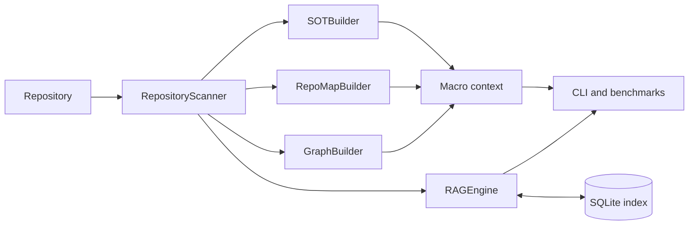

# Architecture

## Overview

The `air-context` entry point in `cli.py` coordinates three independent layers:

- `analysis/` scans source and generates repository-level context;
- `search/` chunks code and maintains the local search index;
- `benchmarks/` measures static quality, retrieval relevance, and local-LLM A/B
  results.

## Data flow

`RepositoryScanner` is the shared policy boundary. It applies the source
allowlist, `.gitignore`, hidden-file and credential exclusions, file-size limits,
binary detection, user deny rules, and canonical-root checks.

`SOTBuilder`, `RepoMapBuilder`, and `GraphBuilder` consume the same scanned file
set and produce `CLAUDE.md`, `repo_map.md`, and `dependency_graph.md`.

`RAGEngine` parses Python with the AST and supported languages with Tree-sitter.
Chunks and sparse statistics are stored in SQLite. Semantic mode stores local
embeddings in the same index; hybrid mode combines lexical and semantic ranks.

The LLM benchmark validates its question schema and repository symbols before
building two prompts: raw source, and generated macro context plus retrieved
chunks. Both are sent to the configured OpenAI-compatible endpoint. Reports
retain configuration, model metadata, usage, latency, retries, errors, evidence,
and repeat statistics. There is no cloud fallback.

## Local artifacts

The tool creates `.air_cache.json`, `.air_index.sqlite3`, `.air-benchmark/`, and
the three generated Markdown files in the analyzed repository. They are local
artifacts and can contain source-derived information, so they are ignored by
default and should be reviewed before sharing.
